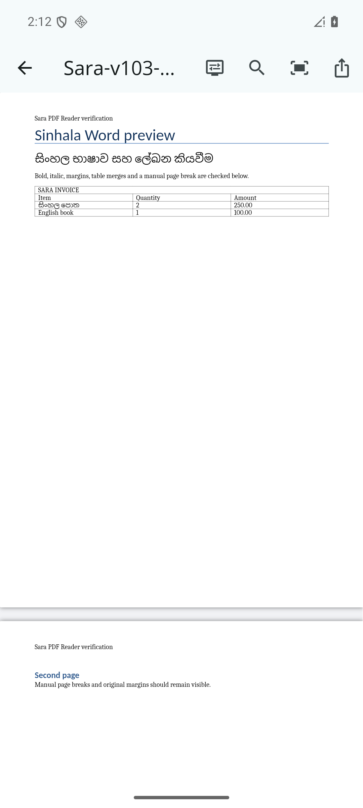
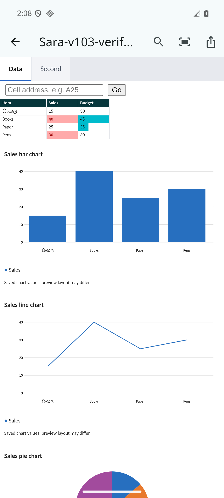
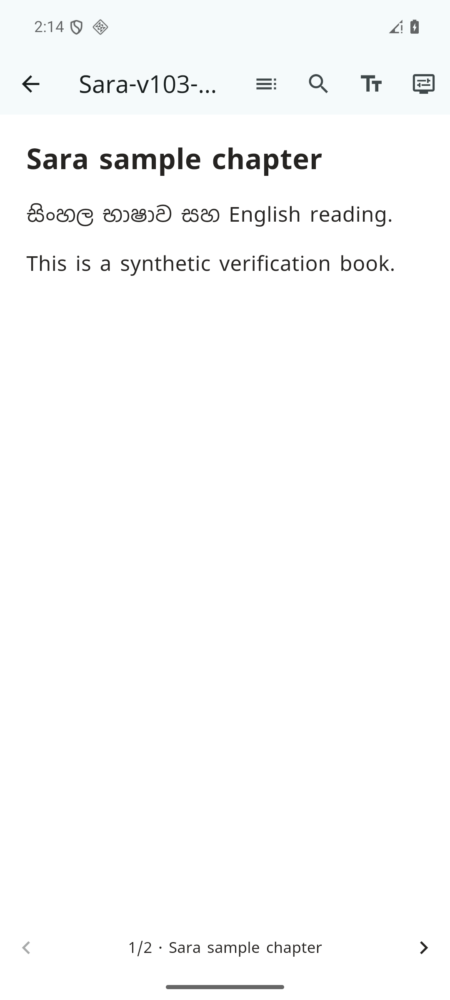

# Sara PDF Reader

Free, open-source Android document reader built with Flutter. Version **v1.11** (Android build 20).
Read PDFs, preview Office documents, read EPUB books and UTF-8 text, and view images locally.
The app was previously developed under the working name Pageflow.
The first release focuses on reading. Editing, file creation and conversion
interfaces are disabled by default; their experimental source remains for future work.
iOS is not a supported release target yet.

## Download the APK

| APK | Download size | Device |
| --- | --- | --- |
| [ARM64 APK](https://github.com/charitha-only/sara-pdf-reader/releases/download/v1.11/Sara-PDF-Reader-v1.11-arm64-v8a.apk) | 58.8 MB | Most modern Android phones |
| [ARMv7 APK](https://github.com/charitha-only/sara-pdf-reader/releases/download/v1.11/Sara-PDF-Reader-v1.11-armeabi-v7a.apk) | 53.1 MB | Phones running 32-bit Android |
| [Universal APK](https://github.com/charitha-only/sara-pdf-reader/releases/download/v1.11/Sara-PDF-Reader-v1.11.apk) | 133.1 MB | Use when unsure which architecture is supported |

All three APKs have the same v1.11 reader features and offline resources. The
universal APK bundles native libraries for ARM64, ARMv7 and x86-64 together;
the smaller APKs include the libraries for one architecture. Sizes use MiB,
rounded to match GitHub's displayed MB sizes.

- [Latest release and update notes](https://github.com/charitha-only/sara-pdf-reader/releases/latest)
- [All versions and their separate downloads](https://github.com/charitha-only/sara-pdf-reader/releases)

Each release has its own version tag, update notes, signed APK and SHA-256
checksum. Older releases remain available when a new version is published.
Install the APK on Android 8 or later. To update an existing installation,
download and install the newer APK from the same publisher; the signing key
must match. The current release label and Android version name are **v1.11**;
Flutter's internal semantic version is `1.1.1+20`.

See [RELEASING.md](RELEASING.md) for publishing the next version.

## v1.11 improvements

- Fix PowerPoint numeric zoom: 50–300% and Original size now use the requested scale, including slides narrower than the viewport. Previously slides were always reduced to width.
- Add Fit page / overview for Word, Excel, PowerPoint and legacy Word previews, using the available view height as well as width. Large sheets may look small in overview; use Fit width or numeric zoom for reading.
- A shared bounded scale calculation preserves authored table/cell/slide geometry and supports resizing without changing the original document. Existing merged-cell/print-range/resource limits remain in place.
- Excel custom font styles now retain the requested font first and include the bundled Sinhala font as a glyph fallback, alongside the existing metric-compatible Office substitutes.

See [update notes](release-notes/v1.11.md).

[Download the Sara logo PNG](https://github.com/charitha-only/sara-pdf-reader/releases/download/v1.11/Sara-PDF-Reader-logo.png).

## Reader previews

Synthetic verification documents shown in the signed release:

| Word / Sinhala | Excel charts | EPUB |
| --- | --- | --- |
|  |  |  |

## Reading support

| Format | Current support | Important limits |
| --- | --- | --- |
| PDF | Native PDFium rendering, zoom, fit width/page, search, bookmarks, thumbnails, sharing | Scans display as images; optional read-only Sinhala/English OCR panel; recognition is approximate; import up to 256 MB |
| EPUB | Native reflowed text/images, chapters, search, appearance, resume | Unencrypted EPUB 2/3 XHTML content; no scripted/multimedia or fixed-layout fidelity; up to 40 MB |
| DOCX / DOCM | Offline pages, text, tables, images, headers/footers/endnotes, Sinhala fallback fonts | Font substitutions, floating objects and page breaks may differ; macros never run |
| XLSX / XLSM | Sheets, merges, dimensions, borders, fills, fonts, alignment, saved formula values | Up to 3,000 rows / 200 columns, 60,000 cells per sheet, 250,000 cells per workbook and 100 sheets; basic cached bar/line/pie/doughnut charts and numeric/text/RGB conditional previews; advanced charts, pivots and formula rules unsupported; no recalculation |
| PPTX / PPTM | Offline slide preview | Complex layouts may differ; no animation or macro execution |
| DOC | Legacy Word text, styles, tables, inline images and textbox content | Approximate layout; up to 20 MB |
| XLS | Legacy spreadsheet stored values | Limited formatting |
| PPT | Legacy presentation text | Text preview, not original slide rendering |
| RTF | Basic formatted text | Not full Word layout |
| CSV / TSV | Table preview | Spreadsheet row/column limits apply |
| TXT / plain | Read-only selectable UTF-8 text | Up to 8 MB; other encodings are not guaranteed |
| PNG / JPG / JPEG / WebP / GIF / BMP | Zoomable image preview | Up to 32 MB; bounded decoded resolution |

**Support does not mean 100% fidelity for every file.** This app does not use
Microsoft's Office layout engine. Missing fonts use bundled open substitutes.
Encrypted Office files cannot be unlocked. Damaged and unsupported files may
fail with an error. General Office preflight permits up to 80 MB compressed,
with archive size, ratio and entry checks.

## Privacy

Release Android builds request no Internet permission. Reading engines, fonts
and Sinhala recognition resources are bundled. Documents are copied to private
app storage; Office previews are private caches, pruned at 200 MB. Recognized text is a private temporary cache. Clearing the library
also clears the saved scan draft, Office and OCR preview caches. Sharing creates temporary copies with read grants
for the selected receiving app. Original selected documents remain unchanged.
Debug builds can have network access for Flutter development tooling.

## Build and run

Tested with Flutter **3.47.6**, Dart **3.13.5**, JDK **17-compatible tooling**
and Android SDK **36**. Android minimum is **8.0 / API 26**.
Install Flutter and Android SDK/NDK tooling, accept the Android SDK licenses,
then run from the repository root:

```sh
flutter pub get
flutter analyze
flutter test
flutter run
```

All patched path dependencies are included under `third_party/`. Do not replace
them with upstream versions without reviewing their `PAGEFLOW_PATCHES.md` files.
Gradle wrapper files are included. Flutter creates machine-local Android SDK
configuration on first run. The application ID is `app.pageflow.reader`; use
your own ID when distributing a separate fork.

### Release signing

The original publisher's private key is intentionally absent. To build your own
signed release, create a PKCS12 signing key and copy
`android/key.properties.example` to `android/key.properties`. Fill in your own
values locally. Both keys and credentials are excluded from Git. The release
build derives its runtime certificate check from your configured certificate.
An unsigned release will not pass that check.

```sh
flutter build apk --release --obfuscate --split-debug-info=work/release-symbols
flutter build appbundle --release --obfuscate --split-debug-info=work/release-symbols
```

Keep your signing key and symbol files securely. A fork signed with a different
key cannot upgrade the original publisher's app. For Play App Signing, review
the certificate check against the actual distribution certificate before release.

### Verification

`flutter test` runs the application unit/widget suite. Office engine tests:

```sh
cd third_party/offline_document_viewer
flutter pub get
flutter test
```

With an Android device/emulator connected, run the generated-data reader smoke suite:

```sh
flutter test integration_test/reader_launch_test.dart -d DEVICE_ID
```

The reader baseline was previously checked offline against four private
Word/Excel examples and with a receiving app for sharing. Those documents,
base64 fixture data, screenshots, helper apps and private verification logs are
not distributed in this repository. The public Android smoke suite covers
generated PDF import, reading controls, a tall generated image and read-only text.
Do not treat those checks as exhaustive coverage of all document formats.

## License and contributions

Original Sara PDF Reader code is MIT licensed; see [LICENSE](LICENSE). Dependencies,
fonts, bundled engines, model data and vendored code retain their own licenses.
Full notices are in [THIRD_PARTY_NOTICES.txt](assets/licenses/THIRD_PARTY_NOTICES.txt)
and the relevant dependency directories. See [CONTRIBUTING.md](CONTRIBUTING.md).
